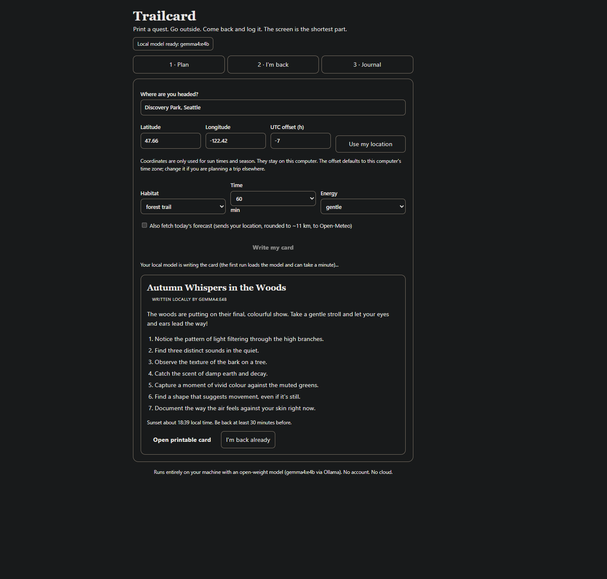
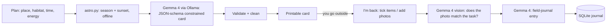

# Trailcard

**Print a quest. Go outside. Come back and log it. The screen is the shortest part.**

Trailcard uses an open-weight model running on your own machine (Gemma 4 via Ollama) to write a one-page
"outside quest" card for the place, season, time of day and energy level you have today. You print it, put the
phone in your pocket and go. Afterwards you log what you found (photos optional) and the model writes a short
field-journal entry. The journal tracks the number that matters: minutes outside vs. seconds on the screen.

Built for the [Hacktoberfest Open-Source AI Challenge, Week 1: Touch Grass](https://dev.to/challenges/hacktoberfest-week1-2026-10-05).



## How it works



- **Card writer** (`quest.py`): Gemma is asked for a strict JSON schema (title, intro, 4-8 items, a sit spot, a
  safety note). The prompt asks for *observation* tasks ("find three leaves in three colours"), not collection
  tasks, and forbids touching or picking unknown plants, mushrooms, animals or litter. Output is validated and
  cleaned; if the model is down or returns junk, a deterministic template card is used instead and the UI says so.
- **Daylight and season** (`astro.py`): computed locally from latitude/longitude and date (no network). Checked
  against Open-Meteo within a few minutes for Seattle and Sydney; Sydney in October correctly comes out as spring.
  The card tells you when to be back, 30 minutes before sunset.
- **Photo check** (`identify.py`): the photo is downscaled to 768px and re-encoded, which removes EXIF and GPS
  data, then Gemma's vision input judges `yes` / `partly` / `no`. Only a clear `yes` auto-ticks an item; `partly`
  leaves the decision to you. The check runs at temperature 0 so the same photo gives the same answer.
- **Journal** (`store.py`): SQLite in `data/`. The screen-time number is a client-side visible-tab timer for the
  card you are logging, nothing more.

## Run it

Requirements: Python 3.11+, [Ollama](https://ollama.com), and about 7 GB for the model.

```bash
ollama pull gemma4:e4b
python -m venv .venv && . .venv/bin/activate      # Windows: .venv\Scripts\activate
pip install -e ".[dev]"
python -m trailcard                               # http://127.0.0.1:8765
pytest                                            # 31 tests, no GPU or network needed
```

Settings (environment variables): `OLLAMA_HOST_URL` (default `http://localhost:11434`), `TRAILCARD_MODEL`
(default `gemma4:e4b`; any Ollama model works, vision needs a multimodal one), `TRAILCARD_DATA`,
`TRAILCARD_LLM_TIMEOUT`.

## Measured on my machine

RTX 4080 Laptop (12 GB), `gemma4:e4b` fully on GPU: a card takes about 3 s once the model is loaded (about 80 s
for the first call while it loads); a photo check takes about 1-1.5 s.

## Privacy

Everything runs on `127.0.0.1`. No account, no cloud model, no analytics. The one optional network call is the
"fetch today's forecast" checkbox (off by default), which sends your coordinates rounded to one decimal
(about 11 km) to Open-Meteo.

## Limits (honest ones)

- The model is small. Cards are pleasant and usually concrete, but it sometimes writes generic prompts, and the
  photo check is lenient: it once accepted a red leaf on brown bark for "three shades of brown". Treat it as a
  nudge, not a judge. That is why a human can always tick an item by hand.
- Sunset times are computed from a standard solar formula, not a database; expect errors of a few minutes, and
  none of this is a substitute for knowing your route. The safety note on the card is generic.
- The UTC-offset field is not auto-detected for places other than where your computer is.
- Only English has been tried.

## Why open models

See the write-up: a card for a specific hillside, a specific season and a specific afternoon, plus photos of
where you actually were, is exactly the data you should not have to ship to someone else's server. An open
weight model on a laptop makes that the default instead of a privacy setting.

## License

MIT. Built during the challenge window (Oct 5-11, 2026). Any commit after the deadline is listed here:
none so far.
